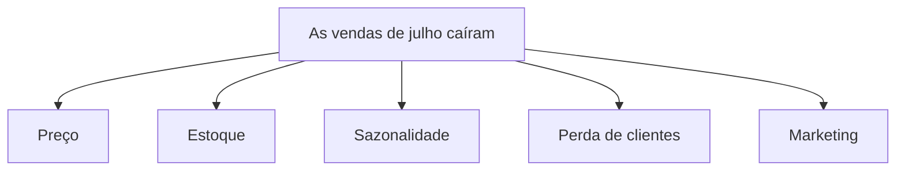

# 03 — Pensamento analítico

Antes de abrir uma planilha, escrever uma consulta ou montar um gráfico, existe uma etapa que decide a qualidade de toda a análise: o jeito de pensar sobre o problema.

## O que é pensamento analítico

Pensamento analítico é a habilidade de abordar um problema de forma organizada: entender o que está sendo pedido, quebrar o problema em partes, fazer perguntas claras, levantar explicações possíveis e verificar o que os dados realmente sustentam, desconfiando das próprias conclusões.

Na prática, ele aparece como uma sequência de cinco movimentos:

As seções seguintes detalham cada um desses movimentos, junto com a habilidade de decompor problemas, que sustenta todos eles.

> [!NOTE]
> Os exemplos deste arquivo usam o mesmo cenário do arquivo anterior: uma loja online que percebeu que as vendas de julho foram menores que as de junho. Os números e situações são fictícios e servem apenas para ilustrar o raciocínio.

## Decompor um problema

Problemas de negócio costumam chegar grandes e vagos, como "as vendas caíram". Para analisá-los, o primeiro passo é quebrá-los em partes menores, que possam ser investigadas uma a uma.

Uma boa decomposição segue um princípio conhecido pela sigla **MECE** (*mutuamente exclusivo, coletivamente exaustivo*): as partes não devem se sobrepor, e juntas devem cobrir todo o problema. Assim, nada fica de fora e o mesmo assunto não é analisado duas vezes.

## Contexto de negócio

Entender o contexto significa saber por que a análise está sendo pedida e como o resultado será usado. Sem isso, é fácil produzir uma análise tecnicamente correta e inútil.

Alguns pontos para esclarecer antes de começar:

| O que entender | Pergunta que ajuda |
|---|---|
| Objetivo | Qual resultado a empresa ou a área quer alcançar? |
| Decisão | Que decisão será tomada com base nesta análise? |
| Stakeholders | Quem pediu, quem vai usar o resultado e quem será afetado? |
| Restrições | Quais são o prazo, os dados disponíveis e os recursos? |
| Definições | O que exatamente significa cada termo? (o que conta como "venda"? cancelamentos entram?) |
| Fatores externos e internos | Houve mudança de preço, campanha, feriado, problema de estoque ou outro evento no período? |

> [!IMPORTANT]
> A pergunta inicial nem sempre é o problema real. "Preciso de um relatório de vendas" pode esconder a dúvida verdadeira: "por que o faturamento caiu e o que fazer a respeito?". Conversar com quem pediu a análise costuma evitar semanas de trabalho na direção errada.

## Perguntas de negócio

Uma pergunta de negócio transforma um problema em algo que os dados podem responder. Quanto mais precisa a pergunta, mais direta é a análise.

| Pergunta vaga | Pergunta analisável |
|---|---|
| Como estão as vendas? | As vendas de julho caíram em relação a junho? Em quais categorias a queda foi maior? |
| O que está acontecendo com os clientes? | A quantidade de clientes que compraram em julho diminuiu em relação a junho? |
| Precisamos melhorar o desempenho. | Quais produtos tiveram a maior queda de faturamento nos últimos três meses? |

Uma boa pergunta costuma ter estas características:

- **Ligada a uma decisão:** a resposta ajuda alguém a escolher o que fazer.
- **Específica:** deixa claro o que será medido e comparado.
- **Com recorte:** define o período, o grupo ou a área analisada.
- **Possível de responder:** existem, ou podem ser obtidos, dados para respondê-la.

A forma da pergunta também indica o tipo de análise necessário, como vimos no arquivo anterior:

| Pergunta | Tipo de análise |
|---|---|
| O que aconteceu com as vendas em julho? | Descritiva |
| Por que as vendas caíram? | Diagnóstica |
| O que deve acontecer em agosto? | Preditiva |
| O que devemos fazer para reverter a queda? | Prescritiva |

## Hipóteses

Uma hipótese é uma explicação possível para o que se observa, formulada antes de verificar os dados. Ela orienta onde olhar, mas não é uma conclusão.

Uma boa hipótese é:

- **Específica:** aponta uma causa e um efeito claros.
- **Testável:** é possível confirmá-la ou refutá-la com os dados.
- **Baseada no contexto:** nasce do que se sabe sobre o negócio, e não de um palpite solto.

Um formato que ajuda a escrevê-las:

> Acredito que **[causa]** contribuiu para **[resultado]**. Se isso for verdade, deveríamos observar **[evidência nos dados]**.

Aplicando ao cenário da loja:

| Hipótese | O que deveríamos observar se for verdadeira |
|---|---|
| O aumento de preço da categoria X reduziu as vendas dela | Queda concentrada na categoria X, depois da data do aumento |
| A falta de estoque impediu vendas | Produtos com estoque zerado durante parte de julho |
| Houve menos clientes comprando | Redução no número de clientes que compraram, e não apenas no valor médio por compra |

> [!TIP]
> Descartar uma hipótese também é um resultado útil. Saber que o preço não explica a queda reduz o espaço de explicações e aproxima a análise da causa real.

## Vieses e armadilhas de raciocínio

Mesmo com bons dados, o raciocínio pode falhar. Vieses são tendências de pensamento que levam a conclusões distorcidas, quase sempre sem que a pessoa perceba. Reconhecê-los é parte do trabalho de quem analisa.

| Viés ou armadilha | O que é | Exemplo na análise |
|---|---|---|
| Viés de confirmação | Procurar, ou valorizar mais, apenas as informações que confirmam o que já se acredita | Estar convencido de que o preço causou a queda e olhar só os dados que mostram isso |
| Viés de sobrevivência | Analisar apenas o que "sobreviveu" a um processo, ignorando o que ficou de fora | Estudar só os clientes ativos para entender por que clientes cancelam |
| Viés de seleção | Usar um grupo de dados que não representa o conjunto que se quer entender | Concluir sobre todos os clientes com base apenas nos que responderam a uma pesquisa |
| Ancoragem | Deixar o primeiro número ou informação recebida pesar demais nas avaliações seguintes | Avaliar todo o resultado do mês em relação a uma meta que foi definida sem critério |
| Escolha seletiva (*cherry picking*) | Mostrar apenas os recortes de dados que sustentam a conclusão desejada | Apresentar só o período em que a campanha parece ter funcionado |
| Confundir correlação com causa | Concluir que um fator causou o outro porque os dois aconteceram juntos | Afirmar que a campanha elevou as vendas só porque ambas subiram no mesmo mês |

### Um exemplo clássico: o viés de sobrevivência

Uma história muito citada para ilustrar esse viés envolve o estatístico Abraham Wald, na Segunda Guerra Mundial. Ao estudar onde os aviões que voltavam das missões tinham sido atingidos, os militares sugeriam reforçar justamente essas áreas. Wald observou que o dado estava incompleto: só os aviões que conseguiram voltar tinham sido analisados. As áreas sem marcas nos aviões que retornavam provavelmente eram as mais críticas, porque os aviões atingidos nelas não voltavam. A lição para a análise de dados é perguntar sempre: **o que não está nos dados que estou vendo?**

> [!NOTE]
> Os detalhes dessa história variam entre as fontes (como o tipo de avião e a instituição envolvida), por isso aqui ela aparece apenas como ilustração da ideia. O conceito de correlação e causalidade será aprofundado mais adiante, no módulo de interpretação, e o de seleção e representatividade dos dados, no módulo de exploração.

### Como se proteger dos vieses

- Escrever mais de uma hipótese antes de olhar os dados, em vez de defender só a primeira.
- Procurar ativamente evidências que contradigam a conclusão favorita.
- Perguntar de onde vêm os dados e quem ou o que ficou de fora deles.
- Mostrar o raciocínio para outra pessoa e aceitar questionamentos.
- Registrar as decisões tomadas durante a análise, para que possam ser revisadas depois.

> Em resumo: pensar bem sobre o problema vem antes de analisar os dados. Entender o contexto, formular boas perguntas, levantar hipóteses testáveis e desconfiar das próprias conclusões é o que separa uma análise confiável de uma coleção de gráficos.