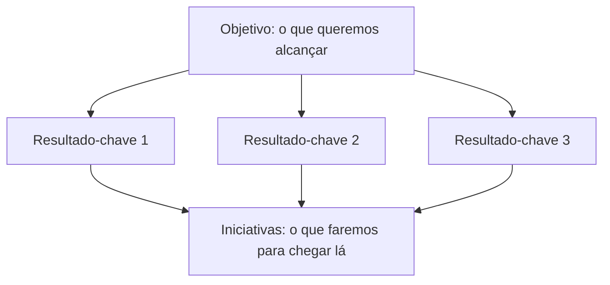
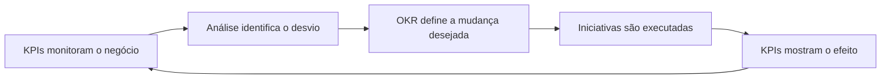

# 05 — Métricas, KPIs e OKRs

Números sozinhos não explicam nada. Para transformar dados em decisões, é preciso saber o que medir, como acompanhar o desempenho e como definir o que se quer alcançar. KPIs e OKRs são as duas ferramentas mais usadas para isso: os KPIs acompanham a saúde do negócio, e os OKRs direcionam os esforços de mudança.

## Métricas, indicadores, KPIs e OKRs

| Conceito | O que é |
|---|---|---|
| Métrica | Uma métrica é um valor que você mede para entender alguma coisa. |
| Indicador | Métrica acompanhada em relação a um objetivo. |
| OKR | Método de gestão que define objetivos (O) e resultados-chave mensuráveis (KRs) para acompanhar o progresso em direção a esses objetivos. |
| KPI | Indicador-chave de desempenho usado para acompanhar o progresso em relação a um objetivo importante. | 

Toda análise usa várias métricas, mas poucas devem virar KPIs. Quando tudo é prioridade, nada é.

## Tipos de métricas

As métricas podem ser agrupadas de formas que ajudam a escolher a mais adequada para cada pergunta.

| Classificação | Tipo | O que é |
|---|---|---|---|
| Forma de cálculo | Absoluta | Total, contagem ou soma |
| Forma de cálculo | Relativa | Proporção, taxa ou razão entre duas medidas |
| Momento | De resultado (*lagging*) | Mostra o que já aconteceu |
| Momento | De tendência (*leading*) | Sinaliza o que pode acontecer |

Métricas absolutas mostram o tamanho; as relativas permitem comparar situações diferentes. Já as de tendência permitem agir antes que o resultado seja afetado, enquanto as de resultado confirmam se a ação funcionou. Um bom conjunto de KPIs costuma combinar os dois tipos.

## KPIs: como definir e acompanhar

Um KPI só funciona quando todos concordam sobre o que ele mede, como é calculado e o que se espera dele. Por isso, cada KPI deve ter uma ficha com os elementos abaixo.

| Elemento | O que define | Exemplo: taxa de conversão |
|---|---|---|
| Nome | Como o KPI é chamado | Taxa de conversão do site |
| Objetivo | Para que ele existe | Medir a eficiência em transformar visitas em compras |
| Fórmula | Como é calculado | Pedidos concluídos ÷ visitas |
| Fonte de dados | De onde vêm os números | Sistema de vendas e ferramenta de análise do site |
| Frequência | Quando é medido e revisado | Semanal |
| Responsável | Quem responde por ele | Equipe de marketing digital |
| Meta | O valor que se quer atingir | 2,50% |
| Referência | Valor histórico ou externo para comparação | 2,50% em junho; média do setor |

### Metas dos KPIs

Uma meta é o valor que se pretende alcançar em um KPI, em determinado prazo. Sem meta, um número não diz se o resultado foi bom ou ruim.

| Conceito | O que é | Exemplo |
|---|---|---|
| Linha de base (*baseline*) | Valor atual ou histórico, usado como ponto de partida | Faturamento de junho: R$ 120.000 |
| Meta | Valor que se quer atingir | Faturamento de julho: R$ 125.000 |
| Realizado | Valor efetivamente alcançado | Faturamento de julho: R$ 105.000 |
| Atingimento | Realizado ÷ meta | R$ 105.000 ÷ R$ 125.000 = 84% |
| Referência externa (*benchmark*) | Valor de empresas ou do setor, para comparação | Taxa de conversão média do setor |

Uma boa meta costuma ser específica, mensurável, alcançável, relevante e com prazo.

> [!IMPORTANT]
> Uma meta definida sem critério distorce a análise. Se for muito alta ou muito baixa, o atingimento deixa de refletir o desempenho real. Vale perguntar como a meta foi definida antes de usá-la como régua.

### Como escolher bons KPIs

| Critério | Pergunta que ajuda |
|---|---|
| Relevância | O KPI está ligado ao objetivo do negócio? |
| Clareza | Todos entendem o que ele mede e como é calculado? |
| Acionabilidade | Alguém consegue agir para mudá-lo? |
| Confiabilidade | Os dados que o alimentam são consistentes e atualizados? |
| Comparabilidade | É possível compará-lo ao longo do tempo ou entre grupos? |

Poucos KPIs que se complementam valem mais do que muitos isolados. Olhar o faturamento junto com pedidos, ticket médio e conversão conta uma história que cada um, sozinho, não conta. Muitos KPIs podem ser decompostos em partes, o que ajuda a descobrir de onde vem uma variação.

## OKRs

**OKR** (*Objectives and Key Results*, ou objetivos e resultados-chave) é um método para definir um objetivo e acompanhar metas em ciclos curtos, geralmente de um trimestre. Ele conecta o que a empresa quer alcançar com como ela vai medir o progresso.

Um OKR tem duas partes:

- **Objetivo (*Objective*):** o que se quer alcançar, escrito de forma qualitativa, clara e motivadora.
- **Resultados-chave (*Key Results*):** como saber se o objetivo foi alcançado, escritos como medidas numéricas com valor inicial e valor-alvo.

### Características de um bom OKR

| Elemento | Um bom exemplo costuma ser | Evitar |
|---|---|---|
| Objetivo | Qualitativo, inspirador, com prazo definido | Números no objetivo, ou frases genéricas como "melhorar tudo" |
| Resultado-chave | Mensurável, com valor inicial e alvo, focado em resultado | Tarefas como "fazer uma campanha" |
| Quantidade | De 2 a 5 resultados-chave por objetivo | Listas longas que dispersam o foco |
| Ambição | Desafiador, mas possível | Metas impossíveis ou sem esforço nenhum |
| Iniciativas | Ações que levam aos resultados-chave | Confundir as ações com os resultados |

## KPI e OKR: diferenças e como se combinam

KPIs e OKRs não competem entre si. Eles têm funções diferentes e se complementam.

| | KPI | OKR |
|---|---|---|
| Função | Acompanhar a saúde contínua do negócio | Direcionar um esforço de mudança |
| Pergunta que responde | Como estamos indo? | Para onde queremos ir e como saberemos que chegamos? |
| Duração | Permanente, revisado com frequência | Ciclo definido, geralmente trimestral |
| Natureza da meta | Manter ou melhorar um padrão | Alcançar algo ambicioso, que exige mudança |
| Quantidade | Poucos, estáveis | Poucos objetivos por ciclo, que mudam a cada ciclo |
| Exemplo | Faturamento mensal | Recuperar o ritmo de vendas em agosto |

Na prática, os KPIs funcionam como um painel de controle: quando um deles sai do esperado, como o faturamento em julho, a análise investiga a causa e a empresa pode definir um OKR para corrigi-la. Os próprios KPIs costumam servir de base para os resultados-chave, como a taxa de conversão e o ticket médio no exemplo acima.

> [!TIP]
> Uma regra simples: se a pergunta é "estamos bem?", use KPIs. Se é "o que queremos mudar neste trimestre?", use OKRs.

## Armadilhas comuns

**Nos KPIs:**

- **Métricas de vaidade:** números que parecem bons, mas não ajudam a decidir. Curtidas e visitas, por si sós, não dizem se o negócio vende mais.
- **Definições inconsistentes:** cada área calcula o mesmo KPI de um jeito, e os números nunca batem.
- **Média escondendo diferenças:** o ticket médio pode permanecer estável enquanto uma categoria cai e outra sobe.
- **Comparar períodos diferentes:** meses com número de dias, feriados ou sazonalidade distintos distorcem a leitura.
- **Perseguir o número, e não o objetivo:** quando uma métrica vira alvo, as pessoas tendem a otimizá-la mesmo à custa do que realmente importa.
- **Excesso de KPIs:** muitos números dispersam a atenção.

**Nos OKRs:**

- **Resultados-chave que são tarefas:** medem atividade, e não resultado.
- **Metas muito fáceis ou impossíveis:** as primeiras não geram desafio, e as segundas desmotivam.
- **Objetivos demais:** sem foco, nenhum é alcançado.
- **Usar OKR como avaliação de desempenho individual:** isso incentiva as pessoas a escolherem metas seguras, contrariando a ideia de ambição.
- **Não acompanhar:** definir os OKRs no início do ciclo e só olhar no final.

> Em resumo: métricas dão sentido numérico às perguntas de negócio, os KPIs acompanham se o negócio está saudável, e os OKRs organizam a mudança que se quer provocar. Saber calcular o ticket médio ou a taxa de conversão é o começo; escolher poucos indicadores bem definidos e transformá-los em metas claras é o que torna a análise útil para decidir.