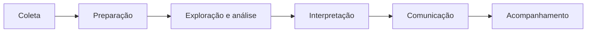
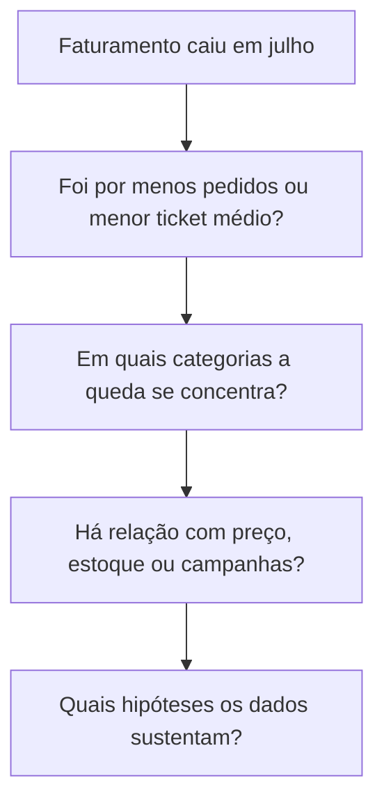

# 06 — Processo de análise de dados

O processo de análise descreve o caminho que os dados percorrem, da obtenção até a apresentação dos resultados e o acompanhamento das ações.

## Etapas do processo

O processo de análise pode ser entendido como uma sequência de seis etapas:

| Etapa | O que acontece | Resultado |
|---|---|---|
| Coleta | Os dados necessários são obtidos das fontes definidas no plano | Dados brutos reunidos |
| Preparação | Os dados são verificados, limpos e organizados | Base confiável para análise |
| Exploração e análise | Os dados são resumidos, comparados e testados | Padrões, diferenças e evidências |
| Interpretação | Os resultados são ligados às perguntas e às hipóteses | Conclusões e limitações |
| Comunicação | Os achados são apresentados ao público certo | Decisão possível |
| Acompanhamento | As ações são monitoradas e os resultados medidos | Aprendizado e ajustes |

> [!IMPORTANT]
> O processo raramente é linear. Ao explorar os dados, é comum descobrir um problema de qualidade que obriga a voltar à preparação, ou perceber que falta um dado e voltar à coleta. Isso faz parte do trabalho e não indica erro.

## Coleta de dados

A coleta consiste em obter os dados definidos no plano de análise. Antes de coletar, vale confirmar o escopo: período, grupos e campos necessários. Coletar apenas o necessário economiza tempo e reduz riscos.

| Tipo de fonte | Exemplos de loja online | Cuidados |
|---|---|---|
| Sistemas internos | Sistema de vendas, estoque e cadastro de clientes | Entender como cada campo é registrado |
| Planilhas | Calendário de campanhas, tabela de preços | Podem ter formatos inconsistentes e versões diferentes |
| Dados externos | Pesquisas de mercado, indicadores do setor | Conferir origem, data e metodologia |
| Pesquisas e formulários | Avaliações e respostas de clientes | Podem representar apenas parte dos clientes |

Boas práticas na coleta:

- **Registrar a origem:** anotar de onde cada dado veio, quando foi extraído e com quais filtros.
- **Guardar o dado bruto:** manter uma cópia original, sem alterações, para poder voltar a ela.
- **Respeitar a privacidade:** usar apenas os dados necessários e proteger informações pessoais.
- **Conferir o volume:** verificar se a quantidade de registros faz sentido para o período e para o negócio.

## Preparação, limpeza e tratamento

Dados reais quase nunca chegam prontos. A preparação garante que a análise parta de uma base confiável, e costuma ser a etapa que mais consome tempo.

Problemas comuns e como tratá-los:

| Problema | Exemplo | Tratamento possível |
|---|---|---|
| Duplicidades | O mesmo pedido registrado duas vezes | Identificar e remover os repetidos |
| Valores ausentes | Pedidos sem categoria | Decidir entre preencher, buscar em outra fonte ou excluir, registrando a escolha |
| Formatos inconsistentes | Datas em formatos diferentes, "R$ 10,50" e "10.5" | Padronizar o formato |
| Categorias inconsistentes | "Eletrônicos", "eletronicos" e "Eletrônico" | Unificar os nomes |
| Valores atípicos (*outliers*) | Pedido de valor muito acima dos demais | Investigar se é erro de registro ou venda real antes de decidir |
| Registros fora do escopo | Pedidos cancelados, quando o plano considera apenas concluídos | Filtrar conforme o escopo definido |

Essa etapa costuma ser dividida em três ações:

- **Limpeza:** corrigir ou remover erros e inconsistências.
- **Tratamento:** decidir o que fazer com ausências e atípicos, de forma justificada.
- **Organização:** estruturar os dados para a análise, por exemplo juntando tabelas ou criando colunas como mês e categoria.

> [!TIP]
> Registre cada decisão de limpeza, como "removi 12 pedidos duplicados" ou "excluí pedidos cancelados". Esse histórico permite revisar o trabalho depois e explicar por que os números têm o valor que têm.

## Exploração e análise

Com a base pronta, começa a investigação. A exploração busca entender o comportamento dos dados; a análise testa as hipóteses e responde às perguntas do plano.

Técnicas básicas, mas muito úteis:

- **Resumos estatísticos:** totais, médias, medianas, mínimos e máximos.
- **Comparações:** período contra período, grupo contra grupo, realizado contra meta.
- **Segmentação:** dividir os dados por categoria, região, tipo de cliente ou canal.
- **Tendências:** observar como uma métrica evolui ao longo do tempo.
- **Relações entre variáveis:** verificar se duas medidas se movem juntas.

Na loja online, a análise poderia seguir esta lógica:

| Hipótese | O que verificar | Resultado possível |
|---|---|---|
| O aumento de preço da categoria X reduziu as vendas | Vendas da categoria X antes e depois do aumento | Queda concentrada depois da data do aumento |
| A falta de estoque impediu vendas | Produtos com estoque zerado e suas vendas no período | Queda nos produtos que ficaram indisponíveis |
| Houve menos clientes comprando | Clientes ativos em junho e julho | Redução no número de clientes, e não só no valor médio |

> [!IMPORTANT]
> Explorar não é procurar algo que confirme o que já se acredita. Os vieses descritos no arquivo de pensamento analítico, como confirmação e escolha seletiva, também aparecem aqui. Teste mais de uma hipótese e procure ativamente evidências que as contradigam.

## Interpretação dos resultados

Calcular um número não é o mesmo que entender o que ele significa. A interpretação liga os resultados às perguntas de negócio e decide o que os dados realmente sustentam.

Perguntas úteis nesta etapa:

- O resultado responde à pergunta do plano?
- A diferença observada é relevante para o negócio ou apenas pequena demais para importar?
- Existem outras explicações possíveis para o mesmo resultado?
- O que é correlação e o que é causa comprovada?
- Quais são as limitações dos dados e do método?

| Nível de certeza | Como comunicar | Exemplo |
|---|---|---|
| Os dados sustentam fortemente | Afirmar com clareza | "A queda se concentrou na categoria X depois do aumento de preço." |
| Os dados sugerem, mas não provam | Usar linguagem cautelosa | "Os dados indicam relação entre a falta de estoque e a queda, mas não permitem afirmar causa." |
| Os dados não permitem concluir | Dizer que falta evidência | "Com os dados disponíveis, não foi possível avaliar o efeito da campanha." |

> [!TIP]
> Dizer "não foi possível concluir" é um resultado legítimo. Também vale indicar qual dado adicional permitiria responder.

## Comunicação e acompanhamento das ações

Uma análise só gera valor quando leva a uma decisão. Por isso, a comunicação deve ser pensada para quem vai usar o resultado, e não para quem fez a análise.

Uma estrutura simples e eficaz:

1. **Resposta principal primeiro:** o que foi descoberto, em poucas frases.
2. **Evidências:** os números e gráficos que sustentam a conclusão.
3. **Limitações:** o que os dados não permitem afirmar.
4. **Recomendações:** o que sugerimos fazer a partir do que foi encontrado.
5. **Próximos passos:** quem faz o quê e até quando.

Cuidados com a apresentação:

- **Adaptar ao público:** a diretoria costuma querer decisões e impacto; a equipe técnica pode precisar de detalhes do método.
- **Escolher bem os gráficos:** cada gráfico deve responder a uma pergunta, sem enfeites desnecessários.
- **Ser transparente:** mostrar as definições e as limitações, para que o resultado possa ser questionado.

### Acompanhamento das ações

Depois da apresentação, o trabalho continua. As ações decididas precisam ser acompanhadas para verificar se funcionaram.

| Ação decidida | Responsável | Indicador de acompanhamento | Prazo |
|---|---|---|---|
| Revisar o abastecimento dos produtos com ruptura | Equipe de estoque | Dias com estoque zerado por produto | Agosto |
| Reavaliar o preço da categoria X | Equipe comercial | Vendas da categoria X por semana | Agosto |
| Campanha para reativar clientes que não compraram em julho | Marketing | Clientes ativos e taxa de recompra | Setembro |

O acompanhamento fecha o ciclo: os resultados das ações geram novos dados, que podem levar a novas perguntas e a uma nova rodada de planejamento.

> Em resumo: o processo de análise vai da coleta ao acompanhamento das ações, passando por preparação, exploração, interpretação e comunicação. Cada etapa depende da anterior, e voltar atrás quando necessário faz parte do método. É esse cuidado, do dado bruto à decisão, que torna uma análise confiável e útil.